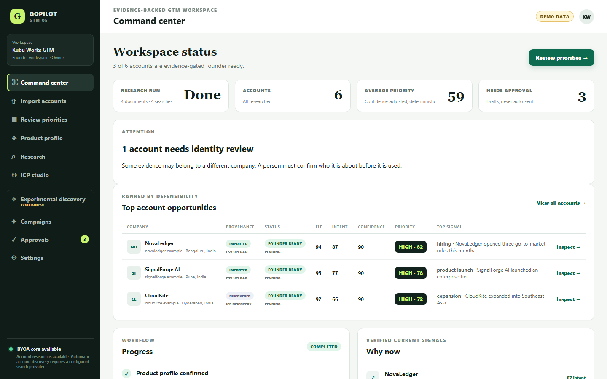
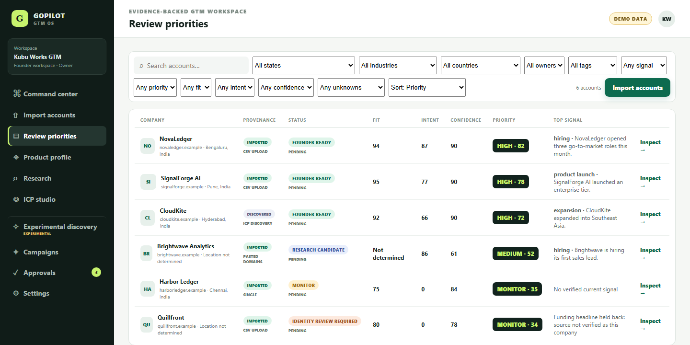
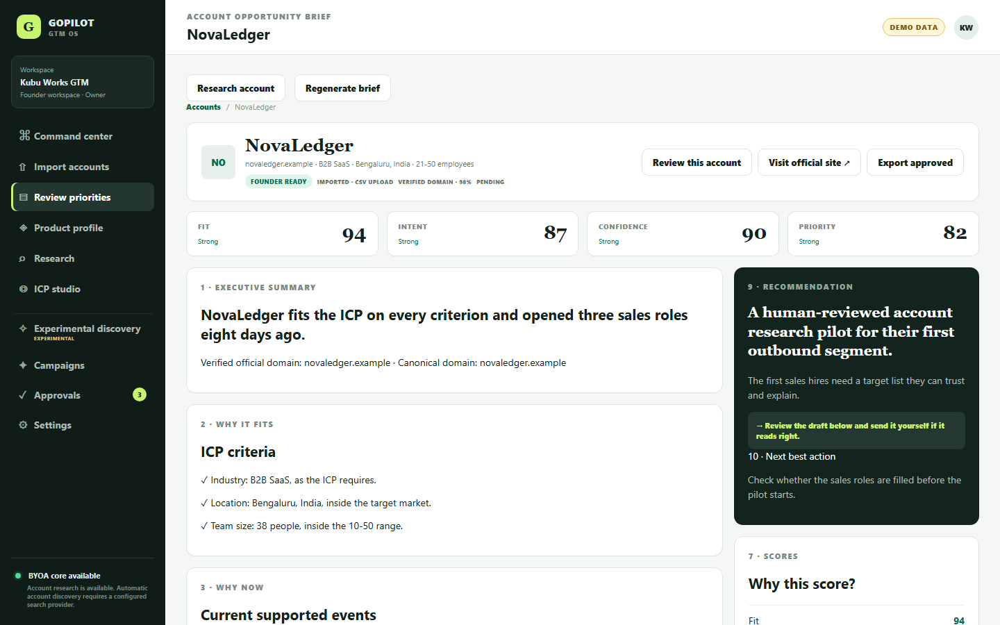
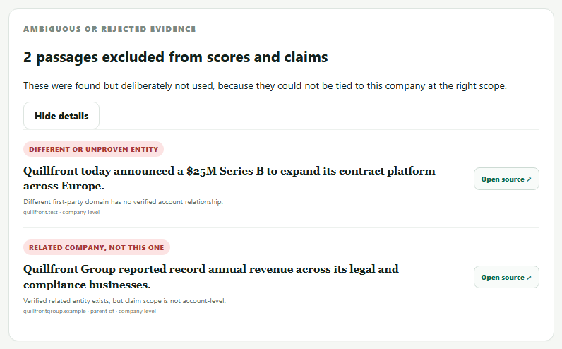
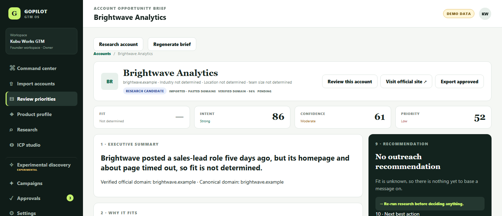
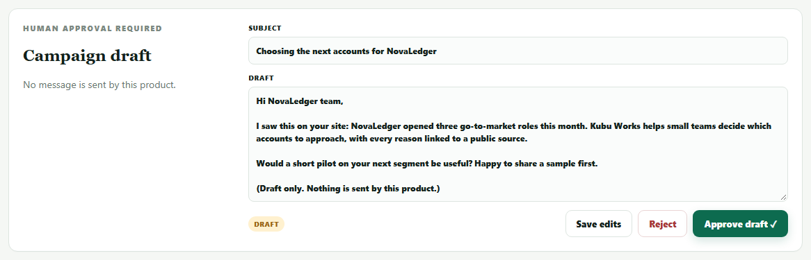

<div align="center">

# GoPilot

**Find out which companies are worth contacting, why, and how sure you can be.**

GoPilot reads each company's own website, checks that what it found really is
about *that* company, scores it with plain arithmetic, and gives you a brief
where every claim links to the sentence it came from.
**Free, open source, no API keys, no AI bill.**

[](LICENSE)
[](https://github.com/kubuworks-rgb/Gopilot---GTMOS/actions/workflows/ci.yml)


[Try it in one command](#-try-it-in-one-command) ·
[Take the tour](#-a-5-minute-tour) ·
[Use your own companies](#-use-it-with-your-own-companies) ·
[Use it from an AI agent](#-use-it-from-an-ai-agent-mcp)



<sub>Every company in these screenshots is made up and lives on a reserved
<code>.example</code> domain. The app labels it <b>DEMO DATA</b>.</sub>

</div>

---

## What it does

You give it a list of companies you're thinking about selling to. For each one,
GoPilot:

| Step | What happens | Why it matters |
|---|---|---|
| 🔎 **Reads** | Fetches the company's own pages: homepage, about, careers, news | You see what the company says about itself, not a database guess |
| 🛡️ **Checks identity** | Throws out evidence that belongs to a *different* company with a similar name | You never write to a company about funding it didn't raise |
| 🧮 **Scores** | **Fit** (do they match who you sell to?), **Intent** (is something happening *now*?), **Confidence** (how much did we actually read?) | Plain arithmetic you can inspect. No AI makes up a number |
| ❓ **Admits gaps** | Missing information shows as **"Not determined"**, never as a fake 0 | A company isn't marked as a poor fit just because its site was down |
| 📝 **Writes a brief** | Summary, evidence, unknowns, risks, next step, plus a draft message only when the evidence supports one | Every sentence links to its source |
| ✋ **Waits for you** | Nothing is ever sent. You edit, approve or reject | You stay in control |

```
Your list → Read official sites → Check identity → Score → Brief → You decide → Export CSV
```

It is **not** a lead scraper, a contact database, a chatbot, or an email sender.

---

## 🚀 Try it in one command

**You need:** [Node.js 20.9+](https://nodejs.org) and [Python 3.11+](https://www.python.org/downloads/).
No Docker, no database, no accounts, no keys.

```bash
git clone https://github.com/kubuworks-rgb/Gopilot---GTMOS.git
cd Gopilot---GTMOS
npm install
npx gopilot -y
```

After about a minute your browser opens at **http://localhost:3000** with a
workspace of six made-up companies, already researched and scored.

<details>
<summary><b>What do these commands do?</b></summary>

- `npm install` installs the web app and the small setup tool.
- `npx gopilot` checks your Node and Python versions, installs Python packages
  if they're missing, starts the API and the web app, waits until both are
  actually responding, then opens your browser.
- `-y` skips the setup questions and starts the demo. Leave it off to choose a
  mode yourself. Later runs remember your choice. Use `--reconfigure` to change
  it, or `--no-open` to stop it from opening a browser.
- Press `Ctrl+C` to stop everything.

</details>

<details>
<summary><b>Something went wrong?</b></summary>

| What you see | What to do |
|---|---|
| `node` or `python` not found / too old | Install the versions above. `npx gopilot` names exactly what to upgrade. |
| "Workspace setup needed / Failed to fetch" | The API isn't running. Stop with `Ctrl+C` and run `npx gopilot -y` again. It waits until the API answers before opening the browser. |
| Port 3000 or 8000 already in use | Close whatever else is using it (often an earlier GoPilot still running), then start again. |
| Still stuck | [Open an issue](https://github.com/kubuworks-rgb/Gopilot---GTMOS/issues) and paste what the terminal printed. |

</details>

---

## 🧭 A 5-minute tour

The demo has six made-up companies. Each one shows a different thing GoPilot
does. Open **Review priorities** in the sidebar and click **Inspect** on any
row.



| Company | What it shows you | Look at |
|---|---|---|
| **NovaLedger** | 🟢 **Ready to contact.** Good fit, posted three sales jobs 8 days ago. Gets a draft message. | The brief and the draft at the bottom |
| **SignalForge AI** | 🟢 Ready. Launched an enterprise tier 18 days ago. | How the *older* signal gives lower intent than NovaLedger's |
| **CloudKite** | 🟢 Ready. Was **discovered** from your ideal-customer profile rather than imported. | The *Provenance* column |
| **Brightwave Analytics** | 🟡 **Strong signal, unknown fit.** Hiring now, but its homepage timed out. | Fit says **"Not determined"**, not 0. GoPilot says to research first |
| **Harbor Ledger** | ⚪ **Good fit, nothing happening.** No current event to mention. | "No current high-confidence signal": monitor, don't message |
| **Quillfront** | 🔴 **Identity check caught a lookalike.** A "$25M Series B" headline came from a different domain. | The **rejected evidence** panel |

### Every claim links to its source

Open **NovaLedger**. Each section answers one question: why it fits, why now,
what's verified, what's unknown, what could go wrong, and what to do next.
Click **View evidence** on any claim to see the exact sentence and the page it
came from.



### It refuses evidence about the wrong company

Open **Quillfront** and click **Show what was excluded**. Two passages were
found, and both were kept out of the scores:



- `quillfront.test` uses the same name but has **no proven link** to
  `quillfront.example`, so the Series B news is held back.
- `quillfrontgroup.example` is the **verified parent company**. Its revenue
  news is real, but it is about the parent, not this company.

Both decisions come from the real identity-check code, not from hard-coded demo
text. That code is [packaged separately](packages/entity-safety) so you can use
it in your own projects.

### "Not determined" is an honest answer

Open **Brightwave Analytics**. Its homepage and about page timed out, so
GoPilot doesn't know what the company sells. It doesn't guess and it doesn't
score fit as 0. It says so and tells you what to retry.



### Nothing is sent without you

Only companies marked **FOUNDER READY** get a draft. You can edit it, approve
it, or reject it. **GoPilot never sends anything.** Approving marks it ready
for *you* to send from your own email. Approved accounts can be exported as a
CSV from the account page.



**Try these in the demo:** change a review state, leave a note, edit and approve
a draft, or filter the list by owner, tag, signal or priority. To try importing,
go to **Import accounts** and upload [`examples/accounts.csv`](examples/accounts.csv).

---

## 🏢 Use it with your own companies

The demo shows what the app does. To research **real** companies, switch to live
mode. It still needs **no API keys**, because it reads each company's own
website directly.

**1. Start live mode.** This also needs [Docker Desktop](https://www.docker.com/products/docker-desktop/),
which runs the database:

```bash
npx gopilot --reconfigure
```

Choose **Live research**. If Docker is running, GoPilot offers to start the
database for you.

**2. Describe what you sell.** The first screen asks for your company, your
product, and who you sell to (for example *"Founder-led B2B SaaS companies in
India, 10–50 people"*). This is what **Fit** is measured against.

**3. Click "Start live research"** on the **Product profile** page. This turns
your description into the target profile your accounts are scored against.

**4. Add companies.** Go to **Import accounts** and either:
- type one company name and domain,
- paste a list of domains (one per line), or
- upload a CSV like [`examples/accounts.csv`](examples/accounts.csv):

```csv
company_name,domain,owner,tags
PostHog,posthog.com,Asha,example
Basecamp,basecamp.com,Asha,example
```

Only `company_name` and `domain` are required. You can also add `industry`,
`country`, `employee_band`, `notes`, `crm_id`, `owner` and `tags`.

**5. Let it research.** Each company's official pages are fetched, checked and
scored in the background. Refresh the list to see results come in.

**6. Review.** Sort by priority, open each brief, and read the evidence. Mark
each account: approve, request changes, flag wrong identity, or not relevant.

**7. Export.** Download approved accounts as CSV for your CRM or spreadsheet.

<details>
<summary><b>Prefer to run each piece yourself instead of the wizard?</b></summary>

```bash
pip install -r apps/api/requirements-dev.txt
npm install

npm run dev                                                    # demo mode

docker compose -f deploy/docker-compose.dev-infra.yml up -d    # database + queue
npm run dev:live                                               # live mode

npm run dev:oidc    # real browser sign-in against a bundled test login server
```

`npm run dev:oidc` starts [`services/dev_oidc`](services/dev_oidc), a test
sign-in server that refuses to start outside development, so you can try the
real sign-in flow without registering with a provider. For production setup see
[docs/operations/DEPLOYMENT_RUNBOOK.md](docs/operations/DEPLOYMENT_RUNBOOK.md).

The optional `apps/api/requirements-gateway.txt` installs Agent Reach, an
extra tool the research gateway can report on. It is off by default and the
core workflow doesn't use it.

</details>

### Demo mode vs live mode

| | **Demo** (`npx gopilot -y`) | **Live** |
|---|---|---|
| Companies | 6 made-up ones, already researched | Yours |
| Internet access | None | Reads each company's own site |
| Needs | Nothing extra | Postgres + Redis (Docker starts them for you) |
| API keys | None | None |
| Labelled | **DEMO DATA** | **LIVE PUBLIC DATA** |

---

## 🤖 Use it from an AI agent (MCP)

GoPilot includes an [MCP server](services/mcp_server), so Claude Code, Claude
Desktop, Cursor, Windsurf, Zed, Cline or any other MCP client can use it:

```json
{
  "mcpServers": {
    "gopilot": {
      "command": "python",
      "args": ["-m", "services.mcp_server.main"],
      "cwd": "/absolute/path/to/Gopilot---GTMOS",
      "env": { "PYTHONPATH": "/absolute/path/to/Gopilot---GTMOS" }
    }
  }
}
```

It has three tools. `list_accounts` and `get_account_brief` read from a running
GoPilot (the demo works). `check_entity_attachment` needs **nothing running**:

> **You:** I found a Series B announcement on optivian.cloud. Can I use it as
> evidence about optivian.ai?
>
> **Agent** *(calls `check_entity_attachment`)*: No. It's
> `UNATTACHED_ENTITY_AMBIGUOUS`: same name, different domain, and no proven
> relationship between them. Using it would report a funding round optivian.ai
> never raised.

**Read-only by design.** No tool can approve, send or change anything. Those
tools don't exist, and the server only makes `GET` requests. Tests check both.

<sub>Tested against the MCP protocol directly (handshake, `tools/list`,
`tools/call`), not separately inside each client listed.</sub>

---

## 🔒 What GoPilot will never do

These rules are enforced by tests, not just written down:

- **Never send a message.** Drafts wait for a person. There is no send button.
- **Never let AI make up a score.** No LLM is used anywhere in the core. Scores
  are arithmetic, and briefs are built from the verified evidence.
- **Never attach evidence to the wrong company.** 10 relationship types × 6
  claim levels, checked against 17 real lookalike company pairs.
- **Never treat "unknown" as "no".** Missing data is left out and the rest is
  re-weighted, not counted as zero.
- **Never scrape logged-in social media**, bypass CAPTCHAs or paywalls, or
  collect private personal data.
- **Never pass off demo data as real.** It is labelled everywhere, and
  production refuses to run with it.

## 💸 Free, with nothing paid underneath

Plenty of "free" tools need a paid key before they do anything. GoPilot's core
doesn't:

| | |
|---|---|
| Search provider | **None.** It reads company websites directly. |
| AI / LLM API | **None.** No token bill, ever. |
| Data enrichment provider | **None.** Facts come from public pages. |
| Database | **None** for the demo. Live mode uses your own local Postgres and Redis. |

`EXA_API_KEY` and `TAVILY_API_KEY` exist only for the *experimental* discovery
feature, which is off by default. CI runs with both empty so this can't quietly
change.

---

## 🧩 Use the parts on their own

- **[`packages/entity-safety`](packages/entity-safety):** the identity check as a
  small Python package with no dependencies. It answers one question for any
  pipeline: *may this passage support a claim about this company?*
- **[`packages/entity-safety/benchmark`](packages/entity-safety/benchmark):** 17
  tricky lookalike cases you can use to test your own pipeline. A simple
  name-matcher scores 17.6% on them.
- **[`services/mcp_server`](services/mcp_server):** GoPilot for AI agents, as
  above.

## ✅ How we know it works

`npm run test` runs **539 tests**: 485 for the backend, gateway and identity
package, 43 for the web app, and 11 for the setup tool. CI runs them on every
push, and tests the one-command setup on Linux, macOS and Windows. Some real
bugs that were found and fixed:

- **Unknown fit scored as zero.** A live run on 20 real companies found that a
  company with *no* fit evidence got a confident 0, which dropped fly.io's
  priority from 64 to 29. Fixed and pinned by a test built from that exact case.
  [Full write-up](docs/qa/LIVE_E2E_FINDINGS.md#2-p0--unknown-fit-was-scored-as-zero-and-it-changed-the-ranking-fixed).
- **Location guessed from a passing mention.** Companies whose site merely
  offered an "India" region were labelled India-based. Location now has to be
  stated outright ("headquartered in …") or it stays unknown.
- **Sign-in check missing on one route.** An invited-users-only check covered
  only one of two routers. Fixed, and a test now fails the build if it happens
  again. See [SECURITY.md](SECURITY.md).

Live mode has also been run end to end against real infrastructure and real
company websites. Results, including what failed, are in
[docs/qa/LIVE_E2E_FINDINGS.md](docs/qa/LIVE_E2E_FINDINGS.md). For an honest
comparison with Clay, Common Room, 6sense and others, including where GoPilot is
*not* better, see
[docs/product/COMPETITOR_POSITIONING.md](docs/product/COMPETITOR_POSITIONING.md).

---

## 🛠️ For developers

<details>
<summary><b>Architecture</b></summary>

```
Browser → Next.js web app → FastAPI API → demo data                    (demo mode)
                                       └→ Postgres → Redis → worker     (live mode)
                                                              └→ research gateway → public websites
```

The research gateway is the only part allowed to make outbound web requests,
and it refuses redirects to other domains. Scoring, identity checks and access
control are ordinary deterministic code. See [ARCHITECTURE.md](ARCHITECTURE.md)
and [docs/architecture](docs/architecture).

</details>

<details>
<summary><b>Repository layout</b></summary>

```
cli/          npx gopilot: checks, setup wizard, starts and stops everything
apps/
  api/        FastAPI backend: routes, services, migrations, tests
  web/        Next.js app
services/
  research_gateway/   the only thing allowed to fetch web pages
  worker/             runs live research jobs in the background
  mcp_server/         GoPilot for AI agents
  dev_oidc/           test sign-in server for local development only
packages/
  entity-safety/      the identity check, as a standalone package
examples/     sample CSV to import
deploy/       Docker Compose and reverse-proxy config
docs/         product, architecture, operations, security, QA
scripts/      maintenance and verification scripts
```

</details>

<details>
<summary><b>Commands</b></summary>

```bash
npm run dev          # demo mode
npm run dev:live     # live mode (needs the database running)
npm run test         # all tests
npm run lint         # ruff + eslint
npm run typecheck    # mypy + tsc
npm run build        # production web build
npm run mcp          # MCP server over stdio
```

</details>

<details>
<summary><b>Build on it or fork it</b></summary>

[docs/EXTENDING.md](docs/EXTENDING.md) shows exactly where to change things:
adding a research source, changing the scoring formula, changing what counts
as valid evidence, changing account states, and adding an API endpoint. It also
lists the rules the tests will hold your changes to.

Forks are welcome. The core ideas (evidence tied to the right company, scores
you can audit, unknown kept separate from zero, a person approves every action)
aren't specific to sales. They fit **recruiting** (researching employers),
**VC deal sourcing** (a parent company's funding round isn't the subsidiary's)
and **franchise or real-estate qualification** (local operators share a brand
with a separate parent). If you build something, an issue telling us about it
is very welcome.

</details>

## Contributing · Security · License

- **Contributing:** see [CONTRIBUTING.md](CONTRIBUTING.md), including the design
  rules every pull request is checked against.
- **Security:** report vulnerabilities as described in [SECURITY.md](SECURITY.md).
- **License:** [MIT](LICENSE). Use it, change it, ship it.

<div align="center">
<sub>If GoPilot saved you from emailing the wrong company, a ⭐ helps other people find it.</sub>
</div>
